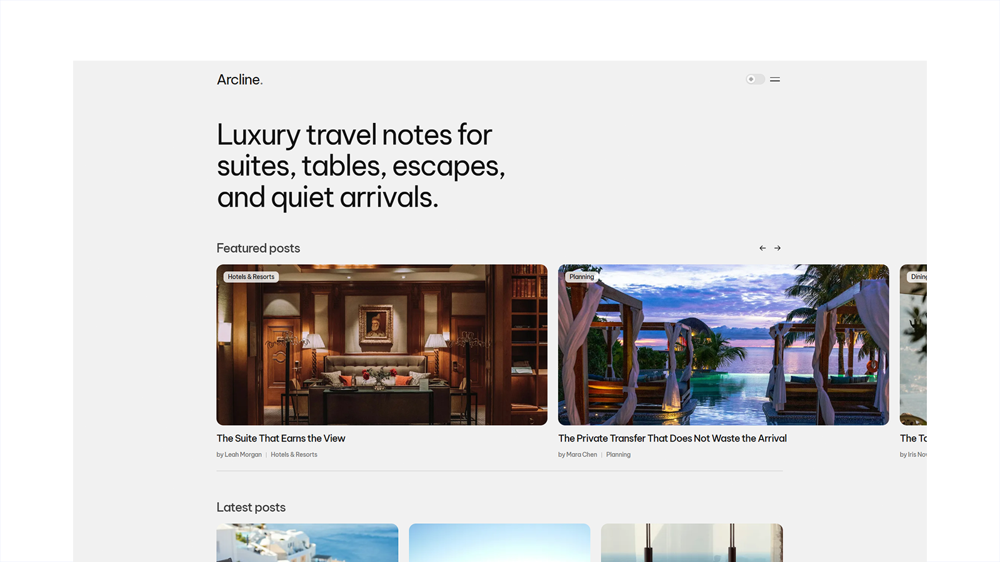

# Arcline - Astro Luxury Travel Publication Theme

[](https://arcline.xocoweb.workers.dev/)

[](https://astro.build/)
[](https://tailwindcss.com/)
[](https://www.typescriptlang.org/)
[](./LICENSE)

**Live preview:** https://arcline.xocoweb.workers.dev/

Arcline is a quiet, photography-led Astro theme for luxury travel publications. Warm paper, white cards, and one black control colour carry the interface, so resort covers, suite views, dining rooms, yachts, spas, and city-luxury photography supply the visual drama. Type is set tight at light weights in self-hosted Be Vietnam Pro, the front page opens on a display headline rather than a hero image, and articles read in a 620px column with a sticky contents rail beside them. Categories, navigation, featured stories, and SEO defaults all come from a small set of config files, so a publication can be renamed and re-scoped without editing components. Content is plain Markdown validated by Astro content collections, and the output is static: fast pages, crawlable articles, and no framework islands to hydrate.

## Features

- Editorial front page: a display intro, a self-advancing scroll-snap featured carousel that bleeds off the page edge, and a three-column latest-posts grid
- The carousel's progress bar reads straight from the track's scroll position, so it fills as slides go past and is full on the last one by autoplay, arrow, or swipe; hover, focus, or a hidden tab pauses the advance
- Luxury-travel categories for hotels and resorts, private escapes, city luxury, wellness and spas, dining, and planning
- A category row that counts each section's posts and borrows its artwork from the newest one, and a popular-tags row that ranks tags the same way, both generated at build time
- Article pages with a full-width cover and a sticky sidebar carrying the byline, an auto-generated contents rail, tag chips, share actions, and a related-posts row
- Slide-over navigation sheet with a focus trap, a keyboard-friendly command palette (`Ctrl`/`Cmd + K` or `/`), and a dedicated results page
- Dynamic category pages with three configurable archive layouts: featured, grid, and editorial list
- Tag, author, archive, article, search, RSS, robots, sitemap, and 404 pages
- Every archive paginates — all posts, category, tag, and author — with `rel="prev"`/`rel="next"` and page one keeping its bare URL
- A membership band driven by the provider-neutral newsletter config
- Markdown content powered by Astro content collections, with styled headings, lists, pull-quotes, links, and in-body images run through Astro's image pipeline
- In-body images can carry a caption and a linked photo credit from the Markdown image's own title slot, without leaving the image pipeline
- Frontmatter validation for titles, excerpts, categories, dates, authors, tags, covers, and drafts
- Read time calculated from the post body at build time
- Central site, navigation, social, and SEO defaults
- Canonical URLs, sitemap generation, RSS, Open Graph, Twitter/X cards, and JSON-LD
- Accessible skip link, landmarks, labels, keyboard-operable dialogs, and visible focus states
- System-aware light and dark modes with a saved reader preference and tiny inline JavaScript only where needed
- Responsive Astro image handling for theme-controlled story images
- Tailwind CSS 4 tokens with no external font or asset requests

## Tech Stack

- Astro 7
- Tailwind CSS 4 via the Vite plugin
- Vite 8
- TypeScript
- Astro content collections
- `@astrojs/sitemap`
- `@astrojs/markdown-remark` with `rehype-slug` for heading anchors and contents links
- Sharp for image processing

## Requirements

- Node.js `22.12.0` or newer
- npm

## Getting Started

```bash
npm install
npm run dev
```

Build for production:

```bash
npm run build
```

Preview the production build locally:

```bash
npm run preview
```

## Deployment

The build is a plain static `dist/` directory, so any static host will serve it. The bundled [wrangler.jsonc](./wrangler.jsonc) is only there because the live preview runs on Cloudflare Workers; it names the project, runs `npm run build`, and serves `dist` as assets. Delete it if you deploy anywhere else; nothing in the theme reads it.

Set `siteConfig.siteUrl` to your own domain before building. Canonical URLs, RSS, `robots.txt`, the sitemap, Open Graph tags, and JSON-LD are all derived from it.

## Customization

See [CUSTOMIZATION.md](./CUSTOMIZATION.md) for site settings, categories, newsletter and contact forms, frontmatter, images, article prose, icons, pages, archive pagination, search, fonts, and theme tokens. The default color mode is set in [src/layouts/BaseLayout.astro](./src/layouts/BaseLayout.astro).

## Content

Posts live in [src/content/posts](./src/content/posts). Each post is a folder with an `index.md` and a `cover.jpg`. Frontmatter is validated by the schema in [src/content.config.ts](./src/content.config.ts).

Arcline is an editorial theme and ships no syntax highlighting or code-block styling. See [Article Prose](./CUSTOMIZATION.md#article-prose) for the Markdown the reading column styles, and for how to turn highlighting back on if a publication needs it.

The bundled demo covers come from [Unsplash luxury travel search results](https://unsplash.com/s/photos/luxury-travel) under the Unsplash License; each post credits its photographer in frontmatter. Three posts also carry an in-body `detail.jpg`, credited in its caption. All of it is free-license Unsplash photography, not Unsplash+. Replace it with your own imagery before publishing.

Author portraits live in [src/config/authors.ts](./src/config/authors.ts), keyed by the `author.name` used in post frontmatter, with the images in `src/assets/authors`. Names with no entry fall back to a monogram avatar. The bundled portraits are Unsplash placeholders; the people photographed have no connection to these fictional bylines, so swap in photos of your real contributors before publishing.

## Typography

Arcline self-hosts [Be Vietnam Pro](https://fonts.google.com/specimen/Be+Vietnam+Pro) (OFL) in weights 400, 500, and 600, split into latin and latin-ext subsets so most readers download three files. [Geist Mono](https://vercel.com/font) sets the keyboard hints in the search palette and is fetched only when that palette is opened. Nothing is fetched from a font CDN.

## Support

See [SUPPORT.md](./SUPPORT.md) for what is included with a license.

## License

Commercial license. See [LICENSE](./LICENSE) for complete terms.
