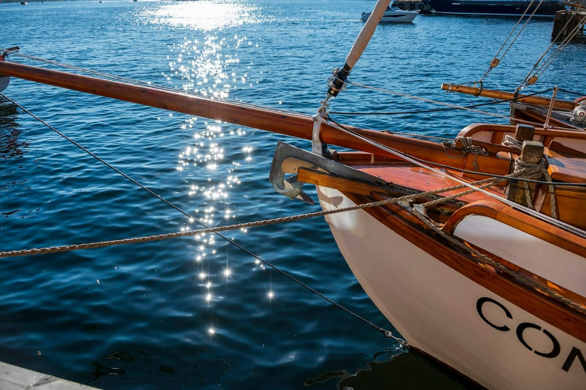

## Why shorter works

Full-day charters invite filler: a slow start, a second bay because the clock says so, lunch that eats the best swimming hour. A half-day charter forces a sharper brief. Leave early, choose one anchorage, swim properly, then return before everyone is sun-drunk and quiet.

## The questions to ask

Confirm the boat itself before you discuss the route:

1. The **exact vessel**, not the class — brokers list a fleet and send what is free.
2. Maximum guests, and how many the shaded seating actually holds.
3. Ladder style, because a bad ladder quietly ends the swimming.
4. Bathroom, towels, soft drinks, and whether fuel is included in the quoted price.
5. Where the captain would go if it were their own afternoon.

That last answer is often better than the standard route, and it is the one question most charter forms never ask.

## The detail that matters

The best charter has a clean re-entry into land: a dock close to dinner, showers at the hotel, and no plan for the hour after. Four hours also leaves the evening intact, which is why a half day sits so well beside [a table booked in advance](/post/the-table-to-book-before-the-flight/) — and why it suits travellers who would rather not give up a night's sleep to the water, as [an overnight cruise](/post/the-overnight-cruise-with-real-sleep/) asks you to. Luxury on water is partly the absence of hurry when you get off it.
