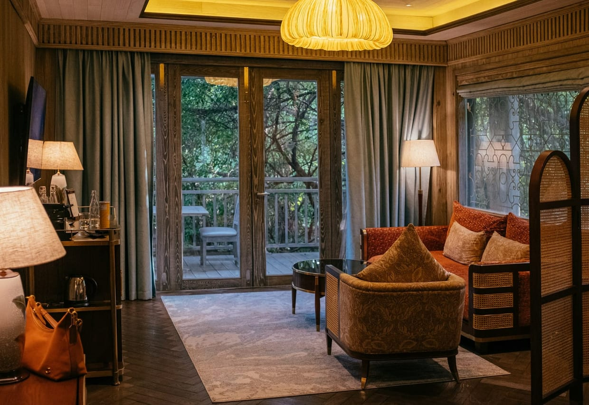

## The view is not the product

A suite with a famous skyline outside the glass can still feel oddly thin. The room has to pace the view: a chair where morning light lands, a bath that lets the city soften, a desk that does not turn the window into office glare. If every piece of furniture faces the same wall, the suite is selling a photograph instead of a stay.

## What to check before booking

Three questions settle most of it before a deposit does:

- Whether the view is **direct or angled**, and from which seat in the room.
- Which floor category actually clears the neighboring buildings, rather than which one is described as high.
- Whether the room in the gallery is the class you are booking, or its best-photographed sibling.

Luxury hotels are usually precise when the answer is good. When the answer becomes vague, book the quieter category and spend the saved money on [the table](/post/the-tasting-menu-worth-dressing-for/).

## The useful indulgence

The rooms worth paying for make the expensive part usable at more than one hour of the day. They have blackout that works, seating for two that is not decorative, lamps that flatter the evening, and a bathroom door that gives privacy without turning the room into a showroom.

A terrace is the honest test of all of it. If it only works for photographs and not for a slow hour with coffee, the suite is thinner than its category suggests — which is why [breakfast on the balcony](/post/breakfast-on-the-balcony-is-a-room-test/) tells you more than a floor plan. The view starts outside, but the value is in how the room lets you live with it.
