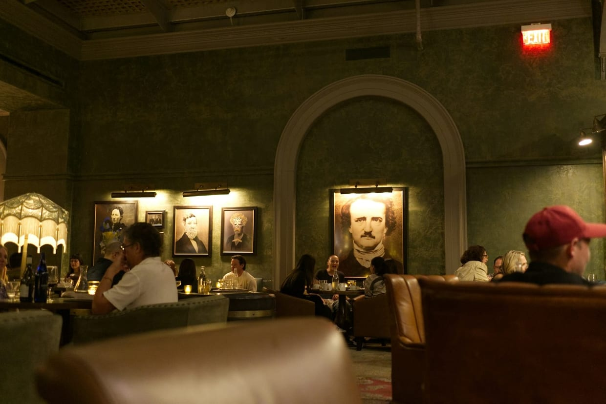

## Length is not luxury

A tasting menu earns its length only when the evening has a shape. There should be an opening that clears the day, a middle with confidence, a pause before the richer courses, and a final hour that lets conversation return. Without rhythm, luxury becomes endurance.

## Book the room, not the ranking

Awards can point you toward competence, but the room decides whether the night feels generous. What to look for, in order of how much it changes the evening:

- **Spacing between tables**, which sets how freely you can talk.
- A wine list with interesting half bottles, not only trophies by the glass.
- Service that can explain a dish without performing it.
- A table you would choose twice, which usually means [asking for it before the flight](/post/the-table-to-book-before-the-flight/).

> The best luxury dining makes you feel attended to, not watched.
>
> <cite>Iris Novak, on the difference between service and surveillance</cite>

## When to go

Go on the night after arrival, not the last night. A serious dinner is a lens for the rest of the trip: ingredients, local producers, the city's appetite for formality. It reads better when the arrival itself has not cost you the evening, which is the case for [a transfer that protects the first night](/post/the-private-transfer-that-doesnt-waste-the-arrival/). Let the meal inform what you eat next.
